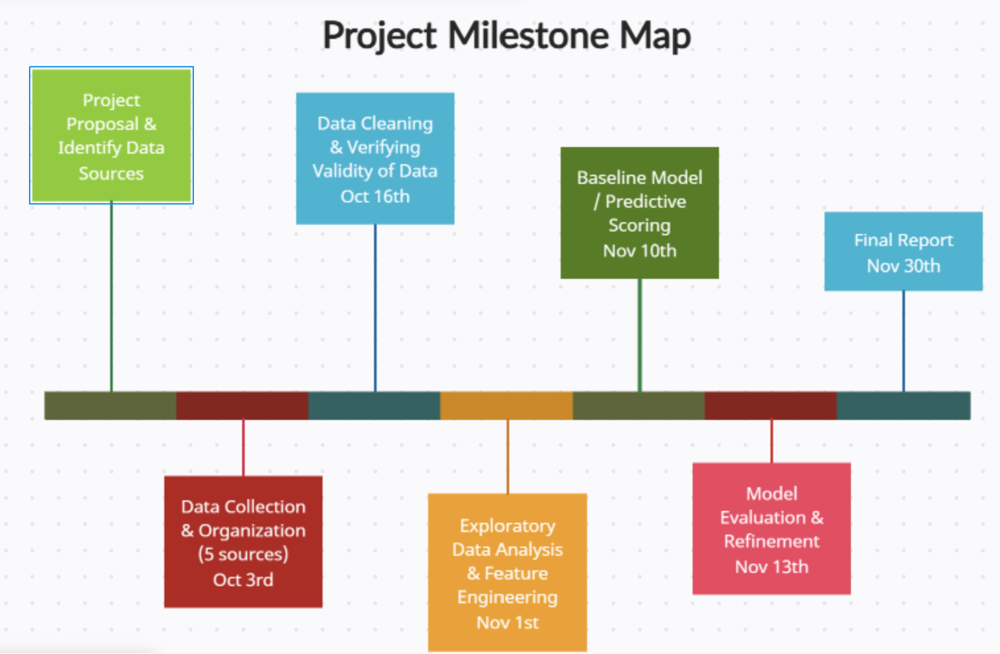

# SkyClarity

**Can you see the sky tonight?** A project to predict night sky visibility in the Boulder, CO area from weather, wildfire smoke, moonlight, and light pollution data.

CSCI 5502 (Data Mining) — CU Boulder

---

## Team Members

| Name | Role |
|---|---|
| Neha Ramachandra | Coordination and Analysis / Modeling |
| Daralynn Rhode | Data and Visualization |
| Shreyas Kulkarni | Documentation and Reproducibility |

## Project Goal

Stargazing conditions in the Boulder, CO area depend on a combination of factors — light pollution, cloud cover, wildfire smoke, and moon or twilight conditions — that aren't currently combined into a single predictive tool. Stargazers, astro-tourism operators, and astronomy educators are left to piece it together themselves, or just guess.

Our goal is to build a model that predicts night sky visibility quality for a given date and time window in Boulder, producing a score or classification that lets people plan ahead rather than relying on guesswork.

**Primary research question:** Can night sky visibility quality in the Boulder, CO area be predicted from a combination of weather, air quality, light pollution, and astronomical factors on a given night?

## Current Research Questions

1. How often are Boulder-area nights clear, smoke-free, and moonless at the same time, and how does that vary by month and year from 2018 to 2025?
2. How much of the summer clear sky advantage is lost to smoke and how does observed night sky visibility differ between wildfire season and the rest of the year?
3. After accounting for site, how strongly are cloud cover, smoke, and moon illumination each associated with observed limiting magnitude?
4. Using only information that would be known the day before how well can next-night sky visibility be predicted, and how does that compare with a site-only baseline?

## OLD Research Questions

1. Given near-term forecast data (cloud cover, air quality forecast, moon phase), how well can next-night sky visibility conditions be estimated in advance?
2. Which factor most degrades visibility — cloud cover, smoke concentration, or moon illumination — and do these factors interact with each other?
3. How does night sky visibility differ between wildfire season and the rest of the year?
4. What does the distribution of night sky visibility conditions in Boulder look like across a multi-year period, in terms of cloud cover, smoke levels, and moon illumination?

*** It was necessary to replace the research questions because of limited data points in different sites, confounding data in terms of light smoke correlating to better visibility than no smoke, and missing data. The new questions are more representative of Boulder data and only make one connection to night-sky viewing since our data may be unreliable. ***

## Data Sources

| Source | Provides |
|---|---|
| [Globe at Night](https://globeatnight.org/maps-data/) (NSF NOIRLab) | Citizen-science reports of naked-eye limiting magnitude, our measure of what observers actually saw |
| [Open-Meteo Historical Weather API](https://open-meteo.com/en/docs/historical-weather-api) | Hourly modelled cloud cover (total, low, mid, high), humidity, temperature, wind and precipitation for each site |
| [EPA Air Quality System (AQS)](https://aqs.epa.gov/aqsweb/airdata/download_files.html) | Validated daily PM2.5 from the nearest ground monitor |
| [NOAA Hazard Mapping System (HMS)](https://www.ospo.noaa.gov/products/land/hms.html) | Daily satellite-traced smoke plumes rated light, medium or heavy |
| [VIIRS Nighttime Lights](https://eogdata.mines.edu/products/vnl/) (Earth Observation Group, Colorado School of Mines) | Annual satellite measurements of artificial light, our light-pollution measure |
| [Skyfield](https://rhodesmill.org/skyfield/) (computed) | Moon phase, moon position and hours of astronomical darkness for every site and night |

Where each source came from, what every column means and how the datasets were built are documented in [`data/README.md`](data/README.md).

### References

- Falchi, F., Cinzano, P., Duriscoe, D., Kyba, C. C. M., Elvidge, C. D., Baugh, K., Portnov, B. A., Rybnikova, N. A., & Furgoni, R. (2016). The new world atlas of artificial night sky brightness. *Science Advances, 2*(6), e1600377.
- U.S. Environmental Protection Agency. (2001, November). *Visibility in mandatory federal Class I areas (1994–1998): A report to Congress* (Appendix C: Methodology for calculating light extinction from monitored aerosol mass data).
- King, B. (2025, June). Wildfires imperil our night skies. *Sky & Telescope*.

### Known Constraints

- No direct ground-truth measure of "dark sky visibility" exists, so a proxy (e.g., sky quality meter readings or citizen reports) is needed — introducing possible bias.
- Wildfire smoke is seasonal, which could skew the model toward certain times of year.
- Observers report mostly on clear nights, so the reports over-represent good conditions.
- Cloud cover comes from a weather model rather than measurements at each site, and Q4 uses the previous night's actual conditions rather than a weather forecast.
- No ability to independently record or check data on the ground, which limits confidence in the model's prediction accuracy.

## Milestone 3: Models & Evaluation

| Script | Answers | Results |
|---|---|---|
| [`src/prep.py`](src/prep.py) | Shared setup for all questions: Boulder-area site list, good-night definition, previous-night features, 2018–2022 / 2023–2025 split | `data/model_ready/` |
| [`src/q1_q2a.py`](src/q1_q2a.py) | Q1 and Q2 Part A: how often nights are clear, smoke-free and moonless, and how much of summer's clear-sky advantage smoke cancels | [`results/q1_q2a/`](results/q1_q2a/) |
| [`src/q2b_q3.py`](src/q2b_q3.py) | Q2 Part B and Q3: wildfire season vs the rest of the year within each site, and site fixed-effects regression of limiting magnitude on cloud, smoke and moon | [`results/q2b_q3/`](results/q2b_q3/) |
| [`src/q4.py`](src/q4.py) | Q4: site-median baseline vs ridge regression vs gradient-boosted trees, using day-before information only | [`results/q4/`](results/q4/) |

Each results folder has a `summary.txt` with the headline numbers, plus the tables and figures shown on the website.

## How to Reproduce

Tested with Python 3.9.6.

```
pip install -r requirements.txt
python src/prep.py
python src/q1_q2a.py
python src/q2b_q3.py
python src/q4.py
```

Run `src/prep.py` first: it builds `data/model_ready/` from the cleaned datasets in `data/processed/`, and the other three scripts read from it. Package versions are pinned in `requirements.txt` and every script sets a random seed. `src/q4.py` takes a couple of minutes because of the tuning search.

The cleaned datasets are already in the repository. To rebuild them from the original sources, see [`data/README.md`](data/README.md) and `data/build_dataset.py`.

## Milestone Roadmap



*SkyClarity — a CU Boulder Data Mining project*